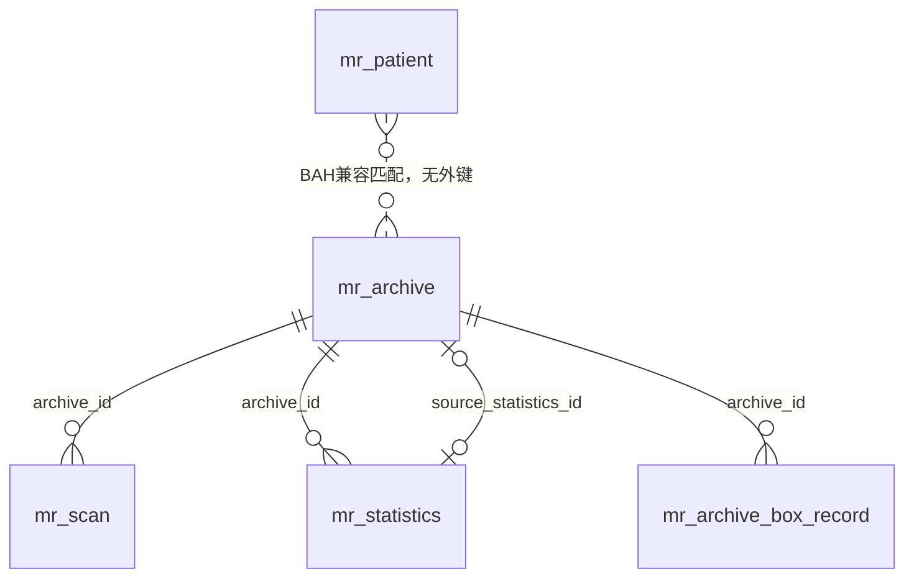

# 病案查询、数据关系与日志排障手册

适用：P1 变更提案 #349。部署边界为 Windows Server、Nginx、Java 21、PostgreSQL 16；下述操作先在合成数据及副本演练。不能以本地测试认定医院“库中有记录但查询为空”的具体原因。

## 查询为空时的现场步骤

1. 在业务页面保留查询模式、时间和追踪编号，点击重试。区分需要上架号、匹配歧义、查询失败、没有有效影像和当前分类无影像。不要把接口错误当空数组。
2. 管理员使用“排查本次查询”：查看请求日志是否已入库、参数模式、主档精确/兼容候选、扫描原值/兼容样本、有效状态、关联 ID 和缓存。诊断是当前时刻只读探测，不能重建过去的数据库状态。
3. 没有访问日志不等于请求没到达：核对 Nginx、浏览器网络状态、本地结构化文件和采集积压。诊断访问日志阶段另需 `log:read`，无权限只显示“未检查”。
4. 主档无记录而扫描有记录：进入数据关系和异常清单；禁止补建猜测主档或选第一个候选。高位 BAH 必须使用 SJH。比较键冲突必须核实来源，不能合并病案。
5. 有有效扫描但业务为空：核对原请求时间、应用版本、schema、响应 `data/meta`、前端当前分类、缓存及较早请求覆盖。刷新影像会沿用已有缓存失效入口。源码中不再自动补零，也不重写存储路径。
6. 有记录而文件打不开：显式运行已有影像来源诊断；业务端只看安全摘要，禁止复制签名 URL、底层异常或真实路径到 Issue。

业务查询仍沿用现有 1–8 位数字输入校验；原始异常历史值可由管理员诊断定位。若医院存在超过此长度的合法业务编号，应先确认来源规则，再单独扩大校验，不通过补零、截断或强制数值转换解决。

## 关系模型与约束



| 字段/关系 | 数据库事实与使用边界 |
|---|---|
| `mr_archive.id` | 病案主档技术主键，影像查询优先使用 |
| 原始 `bah/sjh` | 清理首尾空白；保留前导零，不用于猜测患者身份 |
| `app.numeric_code_key` | 独立比较键，去数字前导零；等价值可能产生歧义，不代表唯一身份 |
| 三个从表 `archive_id` | 历史迁移添加 `ON DELETE SET NULL NOT VALID` 外键；对已有数据是否已验证，必须查实际 `convalidated` |
| `mr_archive.source_statistics_id` | 唯一、可空，引用统计源行，删除源行设 NULL；与统计表的反向主档关联构成依赖，不能据此级联删除 |
| `mr_patient` | 无病案外键；BAH 兼容结果可能多患者、多就诊，仅供有权限的人工核对 |

触发器入口包括 `trg_mr_statistics_sync_archive`、`trg_mr_scan_resolve_archive`、`trg_archive_box_resolve_archive`。新增前向迁移修正 `resolve_scan_archive_reference()`，编号变化后重新解析；歧义或 BAH/SJH 冲突会清除错误关联并保留原编号。不会批量重写历史扫描。

`collect-governance-evidence.ps1` 从系统目录输出真实约束、触发器状态、未验证约束、无效索引、Flyway 和版本摘要。文档描述不能替代现场清单。

关系页概览计数和覆盖率来自 PostgreSQL 统计快照，不在刷新时执行全表COUNT；缺少统计必须显示未知。完整性快照仅检查最近100万 ID 窗口，日常质量规则含最近50万 ID 窗口；样本0不能证明全库正常。后台超时或失败必须显示失败，不显示绿色0异常。

全历史只读扫描使用 `backend-repo/scripts/check-scan-quality.ps1`：检查点绑定 PostgreSQL 系统标识、数据库 OID、service 及规则版本的摘要（取实例标识需要 `pg_monitor` 或相应授权，权限不足直接失败）；固定高水位、ID 有界批次、成功后原子推进检查点，失败重跑不推进。输出只有分类计数，不能替代逐行复核；并发修改需要复查。不得把这个统计脚本作为数据修复脚本。

已有修复预览继续保持只读。历史修复尚未启用：现场确认唯一且可证明的目标后，另建批次修复项，保存记录 ID、旧值、新值、操作者和恢复清单，并以旧值比较防止覆盖并发修改。旧 `backfill-archive-links.ps1` 不提供完整恢复清单，不能直接拿来批量修复现场历史数据。

## 运行日志与隐私

日志源为统一脱敏 JSON 文件，明细按月分区长期入库，错误中心从同一事务的明细投影更新。文件、事件 UUID、字节断点与投影共同保证重读幂等；数据库失败不确认断点。兼容错误采集与文件编码共享事件UUID和错误编号，持久化收据与聚合在同一SQL提交；反复开关采集不会重复计数。收据长期保留并计入数据库容量，不能随错误组清理。日志级别仍由现有 logger 配置控制，不开启全局 DEBUG。

未审核正文、参数及异常消息默认隐藏；保留 logger、级别、时间、追踪编号、错误编号和技术堆栈。旧日志补录也先过滤正文和堆栈。旧格式没有可与旧错误聚合关联的可靠身份，因此只建立历史明细，不重新累计错误中心；新私有格式按共享UUID投影。历史审计读取时脱敏，避免旧数据库内容重新暴露；原历史数据未批量删除。

密钥可由进程环境 `MRR_AUDIT_HMAC_KEY` 或受保护配置 `mrr.audit.hmac-key` 提供，至少32字符，必须与 JWT、外部票据密钥分开。安装目录内运行：

```powershell
powershell.exe -NoProfile -File deploy/windows/initialize-audit-key.ps1 -SecretsFile <受保护的application-secrets.properties>
```

脚本核对实际 DACL，只允许当前操作者、SYSTEM、Administrators 和显式服务 SID，拒绝广泛主体；不打印密钥；备份该受保护配置后重启后端，确认页面 `auditHmacConfigured=true`。没有密钥时编号一律隐藏，摘要检索不可用；不得使用固定默认密钥。历史摘要采用数值比较键；未经计划更换密钥会失去旧摘要检索能力。

参数示例见 `deploy/windows/templates/data-governance.properties.example`，仅将所需条目合并到服务器受保护配置，不能用示例替换整份配置；默认值已由应用提供。原部署模板不改动，密钥由初始化脚本单独写入受保护的secrets文件。

| 开关/限额 | 行为 |
|---|---|
| `app.runtime-logs.enabled=true` | 默认关闭新采集与运行日志接口；副本验收后逐批开启，关闭时仍产生日志文件，现有错误中心保留 |
| `app.operations.query-diagnostics-enabled=false` | 关闭深入查询诊断，保留普通查询 |
| `app.runtime-logs.poll-ms` | 默认2000ms，每轮最多250行；需根据实测积压调整，不以扩大线程数掩盖数据库压力 |
| `app.runtime-logs.buffer-cap` / `buffer-days` | 默认3GB/30天的轮转缓冲边界；达到边界可能淘汰尚未入库文件 |
| 补录 | 固定目录、固定文件名清单，最多128MB解压字节/文件；日期按轮转文件名选择，每批最多20个文件 |

运行日志页面需要 `system:manage` 与 `log:read`；历史补录另需 `system:log:import`。诊断需要 `system:manage` 与 `record:read`。日志读取、诊断和补录都沿用现有访问审计，不记录原始患者输入。

`pollAgeSeconds` 只反映最近成功轮询；积压看待处理文件、原始字节与最早观察时间。压缩文件偏移是解压字节，不能直接减压缩文件大小。页面容量预测只对应缓冲卷；数据库容量增长与数据库卷剩余空间分别核实。

业务优先：异步队列满时不阻塞业务，饱和次数是观察下界。无效行、已登记未确认文件消失会持久化缺口；轮转重读可能产生保守的“可能缺口”，需人工核对后处理。进程崩溃、磁盘满或源文件在登记前就被删除时，精确丢失数量无法保证；“未发现缺口”不是完整性证明。不能以3GB磁盘承诺无限保留。

恢复演练：中断数据库→产生脱敏日志→轮转→重启后端→恢复数据库，确认事件只入库一次、错误聚合不重复、断点推进。再删除合成环境未确认来源，确认缺口持久化。旧格式文件必须显式登记，新的私有格式轮转文件可自动恢复。

## 性能、备份与回滚

记录管理页使用完整比较键与稳定 ID 游标，不同步 COUNT；旧 OFFSET/模糊接口为旧客户端保留。新接口超时3秒；无合适索引时可能超时，必须先在副本构建并验证表达式索引。

`build-code-key-indexes.sql` 在事务外逐条 `CREATE INDEX CONCURRENTLY`。失败先检查同名无效索引，再单独 `DROP INDEX CONCURRENTLY` 后重试；不要修改已发布 Flyway。回滚仅删除这两个新增索引，不改病案数据或编号语义。

`inspect-query-plans.sql` 只执行选定只读 SELECT，5秒超时；计划可能含筛选值，仅在院内留存。记录扫描行数、缓存命中、连接池与锁等待。在相同等量副本和负载下分别关闭/开启采集，使用 `scripts/measure_query_latency.py` 输出 P50/P95/P99，记录实际磁盘增长。失败响应不得参与“达标”结论；P95额外开销≤10%尚需现场实测。

PowerShell 脚本使用 PostgreSQL service/pgpass，不通过参数传密码：

```powershell
powershell.exe -NoProfile -File deploy/windows/collect-governance-evidence.ps1 -Service replica -OutputDirectory <院内证据目录> -ApplicationVersion <版本>
powershell.exe -NoProfile -File backend-repo/scripts/check-scan-quality.ps1 -Service replica -Checkpoint <院内检查点.json> -MaxBatches 10
powershell.exe -NoProfile -File deploy/windows/database-recovery.ps1 -Action Backup -Service replica -Archive <受保护备份目录/backup.dump>
powershell.exe -NoProfile -File deploy/windows/database-recovery.ps1 -Action Verify -Service replica -Archive <备份文件>
powershell.exe -NoProfile -File deploy/windows/database-recovery.ps1 -Action RestoreToEmptyReplica -IsolatedReplica -Service empty-replica -Archive <备份文件>
```

备份须保留在医院受控存储；Verify 只确认归档目录可读，真正恢复必须在隔离空库执行并核对应用查询、Flyway、数据数量与影像来源。脚本拒绝覆盖既有备份及 `.partial`，写入前创建并校验临时文件 ACL；不使用 `--clean`，也不会恢复到非空库。

代码按独立 PR 回退；数据库只做前向修复，新增日志及撤销表保留。不得回滚到 Token 重启重新生效、日志泄露或错误合并病案的行为。医院环境先只读取证，再逐批启用；本次没有在医院执行任何修改。
